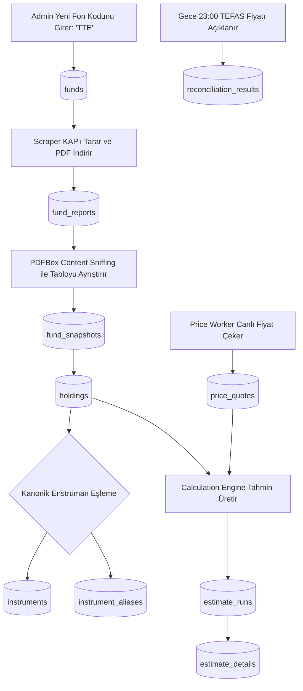
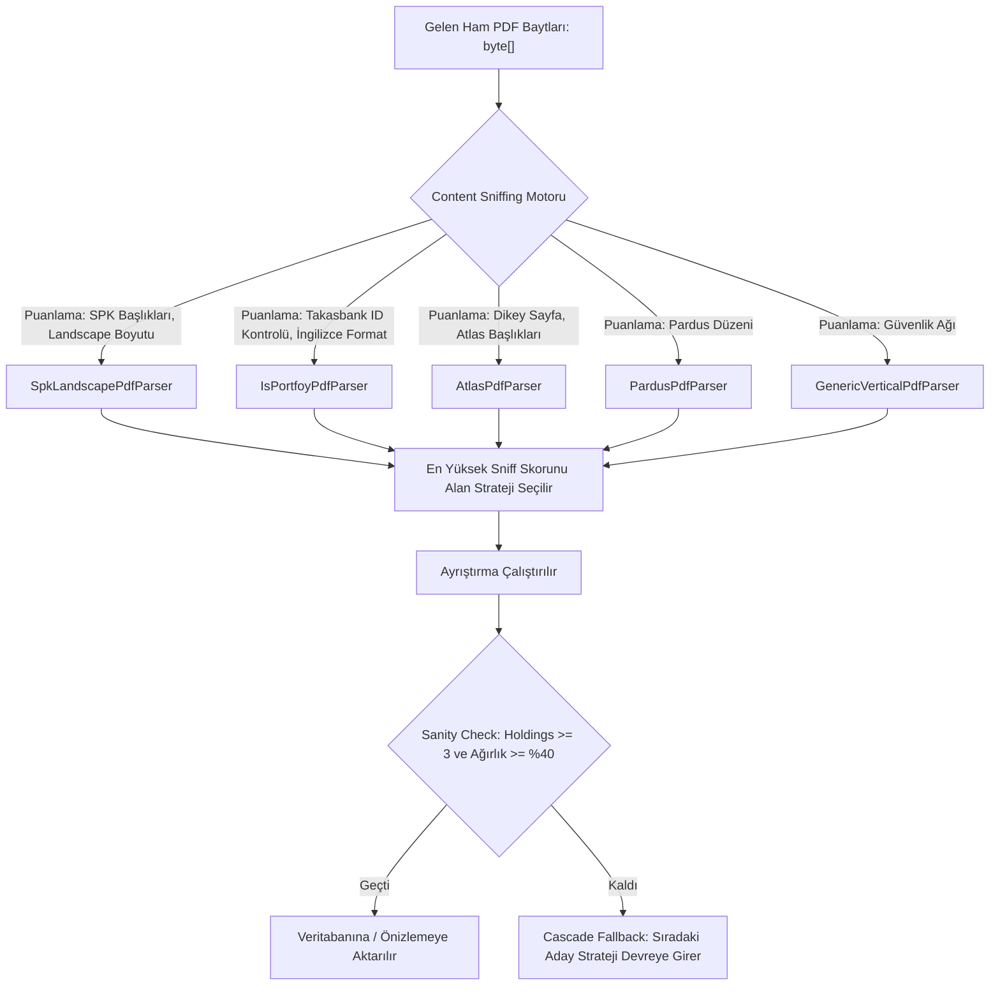
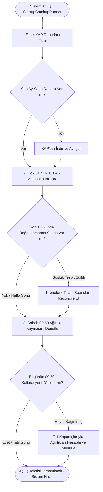
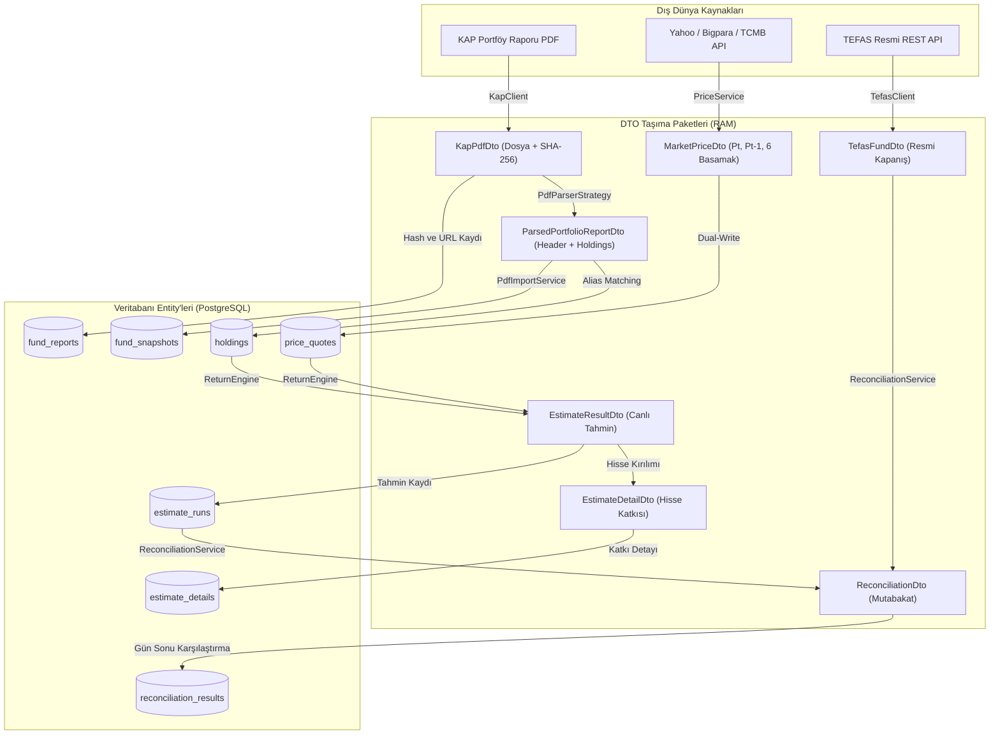

# FONMAP — BIST Seans İçi Canlı Yatırım Fonu Getiri & Portföy Analitiği Platformu


> **"Yatırım fonlarında 18 saatlik seans belirsizliğine son verin."**  
> **FONMAP**; Kamuyu Aydınlatma Platformu'nda (KAP) yayımlanan aylık portföy dağılım raporlarını (PDF) otonom olarak keşfedip **Content Sniffing & Strategy Pattern** ile ayrıştıran, sabah seans öncesi **Ağırlık Kaymasını (Weight Drift)** kalibre edip mühürleyen ve Borsa İstanbul (BIST) seans saatleri boyunca fonların anlık net getirisini ve tahmini pay fiyatını $O(1)$ hızında hesaplayan kurumsal fon analitiği platformudur.

> [!IMPORTANT]
> **📌 Değerlendirici & Mentör İçin Teslimat Notu (Nihai Konsolide Sürüm):**  
> Bu teslimat, projenin **nihai ve eksiksiz konsolide sürümüdür**. Daha önce GitHub reposuna atılmış olan tüm ara commitler veya deneme kodları geçersiz olup doğrudan **bu güncel kod tabanı ve bu kök dokümantasyon dikkate alınmalıdır.**  
> Proje, `docker compose up --build` ile ayağa kaldırıldığında harici PDF veya manuel veri girişi gerekmeksizin **3 örnek vitrin fonu (`TTE`, `KHA`, `ICZ`)** ile anında canlı, dolu ve çalışır halde başlar.

---

## 📑 İçindekiler
1. [Projenin Amacı ve Çözülen Problem](#1-projenin-amacı-ve-çözülen-problem)
2. [Büyük Resim: Sistem Mimarisi ve Veri Akışı](#2-büyük-resim-sistem-mimarisi-ve-veri-akışı)
3. [Akıllı KAP PDF Ayrıştırma Motoru & Content Sniffing](#3-akıllı-kap-pdf-ayrıştırma-motoru--content-sniffing)
4. [Finansal Hesaplama Modeli, Varsayımlar ve Proxy Yaklaşımları](#4-finansal-hesaplama-modeli-varsayımlar-ve-proxy-yaklaşımları)
5. [Dinamik Ağırlık Kayması (Weight Drift) ve Seans Yaşam Döngüsü](#5-dinamik-ağırlık-kayması-weight-drift-ve-seans-yaşam-döngüsü)
6. [Sistem Açılış Telafi ve Senkronizasyon Motoru (Startup Catch-up Engine)](#6-sistem-açılış-telafi-ve-senkronizasyon-motoru-startup-catch-up-engine)
7. [Çok Katmanlı Fiyat Sağlayıcı Zinciri & Resilience4j Failover](#7-çok-katmanlı-fiyat-sağlayıcı-zinciri--resilience4j-failover)
8. [Güvenlik Mimarisi & Geliştirme/Demo Profil Notu (`permitAll()`)](#8-güvenlik-mimarisi--geliştirmedemo-profil-notu-permitall)
9. [Veritabanı Şeması ve Katmanlar Arası DTO Dönüşüm Akışı](#9-veritabanı-şeması-ve-katmanlar-arası-dto-dönüşüm-akışı)
10. [Geriye Dönük Doğrulama (Backtest) ve Gece TEFAS Mutabakatı](#10-geriye-dönük-doğrulama-backtest-ve-gece-tefas-mutabakatı)
11. [Vitrin Fonları Kataloğu (Showcase: TTE, KHA, ICZ) ve Sıfır Sentetik Veri Prensibi](#11-vitrin-fonları-kataloğu-showcase-tte-kha-icz-ve-sıfır-sentetik-veri-prensibi)
12. [Kurulum, Çalıştırma ve Docker Compose Rehberi](#12-kurulum-çalıştırma-ve-docker-compose-rehberi)
13. [REST API Uç Noktaları](#13-rest-api-uç-noktaları)

---

## 1. Projenin Amacı ve Çözülen Problem

Türkiye fon piyasasında (TEFAS) yatırım fonlarının resmi birim pay fiyatları **günde yalnızca 1 kez**, borsa kapandıktan sonra gece saat **23:00 civarında** ilan edilir.

* **18 Saatlik Kör Uçuş:** Borsa İstanbul seansı (10:00 – 18:10) boyunca hisse senedi yoğun fonların (HSYF), teknoloji ve serbest fonların piyasa değeri saniye saniye değişmesine rağmen, yatırımcılar ve portföy yöneticileri gün içinde fonlarının ne kazandırdığını veya kaybettiğini göremez.
* **FONMAP Çözümü:**
  1. **Aylık KAP Dağılımını Okur:** Ayda 1 yayımlanan resmi portföy dağılım raporunu (PDF) otonom olarak indirir ve hisse/türev pozisyonlarını kuruşu kuruşuna ayıklar.
  2. **Ağırlık Kaymasını (Weight Drift) Düzeltir:** Rapor tarihinden bugüne hisselerin farklı prim yapmasıyla değişen gerçek sepet ağırlıklarını her sabah seans öncesi (09:50) günceller ve mühürler.
  3. **Canlı Seans Fiyatlaması Yapar:** BIST canlı tahtasındaki dakikalık fiyatlarla her 60 saniyede bir fonun net getirisini ve tahmini birim pay fiyatını (`1.6853 ₺ ➔ 1.7097 ₺`) hesaplar.
  4. **Akşam TEFAS Mutabakatı Yapar:** Gece 23:00'te TEFAS'ın açıkladığı resmi fiyatla modeli karşılaştırır, MAE (Ortalama Mutlak Hata) ve RMSE hata metriklerini hesaplayarak geriye dönük karne üretir.

---

## 2. Büyük Resim: Sistem Mimarisi ve Veri Akışı

Bir fon sisteme ilk girdiği andan gece mutabakatına kadar veriler modüller ve tablolar arasında şu sırayla akar:



### Katmanlı Mimari Sorumlulukları (Clean Architecture)
* **`fonmap-domain`:** Varlık modelleri (`Fund`, `Holding`, `EstimateRun` vb.), enumlar (`AssetClass`, `ConfidenceLevel`) ve iş anayasası.
* **`fonmap-infrastructure`:** Dış dünya adaptörleri (Apache PDFBox ayrıştırıcıları, `YahooFinancePriceProvider`, `BigparaPriceProvider`, `TefasClient`, `KapClient`, PostgreSQL JPA repoları ve Redis L2 önbellek).
* **`fonmap-application`:** Çekirdek finansal iş mantığı (`ReturnCalculationService`, `WeightDriftService`, `BacktestService`, `PdfImportService`, `ReconciliationService`, `StartupCatchupService`).
* **`fonmap-api`:** REST API uç noktaları, Spring Security JWT filtre zinciri, cron scheduler'lar ve global istisna yakalayıcılar.
* **`fonmap-frontend`:** Next.js 16 (App Router), TypeScript ve Tailwind CSS ile hazırlanan koyu tema finans terminali arayüzü.

---

## 3. Akıllı KAP PDF Ayrıştırma Motoru & Content Sniffing

Türkiye'de 60'tan fazla Portföy Yönetim Şirketi (PYŞ) ve 1.500'den fazla fon bulunmaktadır. Kurucuların KAP'a yüklediği raporlar standart tek bir biçimde değildir:
* **Tera Portföy / SPK Standart:** Yatay (Landscape) tablo, Türkçe sayı formatı (`74.819.592.001,69`).
* **İş Portföy (`TTE`):** Uluslararası İngilizce sayı formatı (`3,867,888,879.64`), 16-22 haneli Takasbank saklama hesap kodları (`80100511...`).
* **Atlas Portföy:** Dikey (Portrait) 3 sayfalık rapor yapısı.
* **Pardus Portföy (`KHA`):** Farklı satır ve sayfa kırılımları.
* **Ak Portföy (`ICZ`):** 399 sayfalık devasa rapor (İlk 2 sayfa portföy, sonraki 396 sayfa yasal işlem defteri).

### Strateji Deseni ve Content Sniffing (Puan Yarışı)
Sistemimiz, kurucu adı veya fon koduna bağımlı kalmadan **dosyanın kendi içeriğini koklayarak (Content Sniffing)** en uygun parser'ı dinamik olarak seçer:



#### Content Sniffing Puanlama Kuralları:
1. **Sayfa Geometrisi:** Sayfa rotasyonu ve en-boy oranı (`mediaBox`) analiz edilir; yatay sayfalar SPK Landscape'e +30 puan kazandırır.
2. **Takasbank İmza Taraması:** `IsPortfoyPdfParser`, metin içinde 16-22 haneli Takasbank saklama kodları (`80100511...`) yoksa puanını sıfırlar; böylece özel saklama formatı kullanmayan diğer fonlar otomatik olarak standart `SpkLandscapePdfParser`'a yönlendirilir.
3. **Cascade Fallback (Kademeli Kurtarma):** İlk seçilen stratejinin çıktısı kalite kontrollerinden geçemezse (toplam ağırlık <%40 veya satır sayısı <3) sistem çökmez; sıradaki aday stratejiyi otomatik devreye sokar.
4. **Çift Dilli Ondalık Ayrıştırma (`parseAutoDecimal`):** Metin içindeki virgül ve noktaların konumları incelenerek Türkçe format (`1.250,50`) ile Anglo-Sakson format (`1,250.50`) otomatik ayırt edilir.

---

## 4. Finansal Hesaplama Modeli, Varsayımlar ve Proxy Yaklaşımları

Hesaplama motoru (`ReturnCalculationService`), şartnamedeki formüllere tam sadakatle çalışır. Finansal piyasa gerçekleri doğrultusunda uygulanan varsayımlar ve proxy modelleri aşağıda açıkça belirtilmiştir:

### 4.1. Temel Getiri Formülü (Formül 4.1)
$$r_{\text{fon}}(t) = \sum_{i=1}^{N} \left( w_i(t) \times r_i(t) \right) - \frac{\text{AnnualFeeRatio}}{252}$$
* $w_i(t)$: Varlığın sabah 09:50'de mühürlenen dinamik açılış ağırlığı.
* $r_i(t) = \frac{P_{i,t}}{P_{i,0}} - 1$: Varlığın dünkü borsa kapanışına ($P_{i,0}$) göre anlık borsa getirisi.
* $\frac{\text{AnnualFeeRatio}}{252}$: SPK onaylı yıllık yönetim giderinin işlem günü (252) bazında sepetten günlük düşümü.

### 4.2. Varlık Bazlı Fiyatlama Varsayımları ve Proxy Modelleri
Finansal piyasalarda her varlığın canlı tahta verisi bulunmayabilir. Sistemimizin uyguladığı proxy metodolojisi şeffaf olarak kayıt altına alınmıştır:

| Varlık Tipi | Sistemdeki Sınıfı | Fiyatlama Metodolojisi & Proxy Yaklaşımı | Gerekçe / Finansal Dayanak |
|---|---|---|---|
| **BIST Pay Senetleri** | `EQUITY` | Canlı BIST tahtasından anlık son fiyat ($P_t$) ve dünkü kapanış ($P_{t-1}$) çekilir. | Tahtası olan varlıklarda doğrudan hisse bazlı getiri $r = \frac{P_t}{P_{t-1}} - 1$ kullanılır. |
| **VİOP Vadeli Kontratlar** | `VIOP` | **Dayanak Varlık Spot Proxy'si:** Vadeli sözleşmenin anlık derinliği yerine dayanak spot hissenin/endeksin getirisi proxy olarak atanır. | VİOP sözleşmelerinin vadeli fiyatı gün içinde dayanak spot hisse hareketini birebir takip eder. |
| **VİOP Kısa (Short) Pozisyonlar** | `VIOP` | Dayanak hisse/endeks getirisi **$-1$ ile çarpılarak** modele dahil edilir. | Hisse değer kaybettiğinde fonun portföyü değer kazanır. |
| **Ters Repo / Takasbank Para Piyasası** | `DEPOSIT` | **TCMB Politika Faizi Nemalandırma Proxy'si:** Tahtası yoktur; TCMB politika faizi referans alınarak günlük faiz neması işletilir: $$r = \frac{\text{Politika Faizi}}{365}$$ | Ters repo ve nakit mevduat gün içi dalgalanma üretmez; günlük faiz tahakkuk ettirilir. |
| **Özel Sektör Tahvili / Bono** | `BOND` | **Nötr Getiri Proxy'si:** Canlı fiyatı bulunamayan tahviller için getiri $r = 0.0$ kabul edilir. | Kupon ödeme günleri dışındaki gün içi fiyat değişimi fon genel getirisine ihmal edilebilir etki yapar. |
| **Nakit Teminatlar** | `DEPOSIT` | Repo faiz oranı üzerinden günlük nemalandırılır. | Fonun VİOP için Takasbank'ta tuttuğu nakit teminat nema getirisi üretir. |

### 4.3. Kapsama Oranı ve Güven Seviyesi Eşikleri (Formül 4.6)
$$\text{Kapsama Orani} = \frac{\sum_{i \in \text{Canli Fiyat}} w_i}{\sum_{j \in \text{Tum Portfoy}} w_j} \times 100$$
* **$\ge$ %85** $\rightarrow$ 🟢 **YÜKSEK GÜVEN (HIGH):** Portföyün ezici çoğunluğu anlık tahta verisiyle fiyatlanıyor.
* **%70 – %85** $\rightarrow$ 🟡 **ORTA GÜVEN (MEDIUM):** Portföyde repo veya tahvil ağırlığı yüksek.
* **$<$ %70** $\rightarrow$ 🔴 **DÜŞÜK GÜVEN (LOW):** Fiyatlanamayan kalem oranı yüksek; panelde kullanıcıya uyarı gösterilir.

### 4.4. Finansal Devre Kesici (Outlier Sanity Guard)
Borsa İstanbul Pay Piyasası'nda hisselerin günlük tavan/taban marjı **±%10**'dur. Fon portföyünde kaldıraç harici net getirinin **±%12**'yi aşması finansal olarak imkânsızdır. Sistem, hesaplanan net getiri $|\text{return}| > 0.12$ olduğunda devreye giren bir koruma kalkanı içerir: değer **±%10.00**'a klemplenir ve güven seviyesi zorunlu olarak `LOW` yapılır.

---

## 5. Dinamik Ağırlık Kayması (Weight Drift) ve Seans Yaşam Döngüsü

KAP raporu ayda bir ($t_0$) yayımlanır. Rapor yayımlandıktan sonra portföy yöneticisi hiçbir işlem yapmasa dahi hisselerin fiyatı farklı oranlarda arttığı için sepet içindeki ağırlıkları kendiliğinden kayar (Weight Drift).

### Matematiksel Model (Formül 4.2)
$$w_i(t) = \frac{w_i(t_0) \times \frac{P_i(t-1)}{P_i(t_0)}}{\sum_{j=1}^{n} \left[ w_j(t_0) \times \frac{P_j(t-1)}{P_j(t_0)} \right]}$$
* $P_i(t-1)$: Hissenin dünkü borsa kapanış fiyatıdır.
* Paydada toplam daima tam **%100 (1.000000)** olarak normalize edilir.

### Seans Yaşam Döngüsü Zaman Çizelgesi
```
   09:50                    10:00 - 18:10                    18:10           23:00 - 02:00
┌──────────────┐         ┌────────────────────────┐       ┌───────────┐   ┌────────────────────────┐
│ Sabah Drift  │ ──────> │  Seans İçi Canlı Akış  │ ────> │ Son Değer │──>│ Gece TEFAS Mutabakatı  │
│  Mühürleme   │         │    O(1) Canlı Hesap    │       │ Mühürleme │   │ (Delta Retry Polling)  │
└──────────────┘         └────────────────────────┘       └───────────┘   └────────────────────────┘
  • T-1 fiyatları          • Dakikada 1 periyot             • 18:10 son     • TEFAS fiyatı çekilir.
  • Ağırlık hesabı         • Sabit açılış ağırlığı            tahmini       • Hata = Tahmin - Gerçek
  • Redis/DB mühür         • r_i(t) canlı fiyat               kaydedilir.   • MAE / RMSE hesaplanır.
```

* **09:50 Mühürlü Ağırlık:** Ağırlık kayması gün içinde değişmez; gün içi getirinin referansı dünkü kapanış ($P_{t-1}$) olduğundan, ağırlıklar da seans öncesinde dondurulur (`DailyHoldingDrift`).
* **$O(1)$ Seans İçi Optimizasyon:** Seans saatleri içinde her dakika geçmiş fiyat serileri sıfırdan taranmaz; mühürlü ağırlıklar üzerinden doğrudan $O(1)$ karmaşıklığında getiri hesaplanır.

---

## 6. Sistem Açılış Telafi ve Senkronizasyon Motoru (Startup Catch-up Engine)

Geliştirme ortamlarında veya sunucu bakım/yeniden başlatma durumlarında sunucu 7/24 kesintisiz çalışmayabilir. Bilgisayar gece kapalı olduğunda **23:00 TEFAS resmi mutabakatı**, sabah kapalı olduğunda ise **09:50 seans öncesi ağırlık kayması kalibrasyonu** kaçabilir.

FONMAP, bu tür kesintiler sonrasında veri bütünlüğünü garanti altına almak için **otonom bir telafi ve senkronizasyon motoruna (`StartupCatchupService` & `StartupCatchupRunner`)** sahiptir.

#### Çalışma Prensibi ve Yaşam Döngüsü:
Spring Boot uygulaması ayağa kalktığında `@Order(10)` önceliğiyle `StartupCatchupRunner` devreye girer ve `StartupCatchupService.runFullCatchupSequence()` metodunu tetikler:



#### 3 Aşamalı Otonom Telafi Akışı:
1. **Aylık KAP Portföy Raporu Telafisi (`catchupMissingKapReportsIfMissed`):**
   * Mesai saatlerindeki (09:00, 11:00, 14:00, 17:00, 19:00) tarama cron'ları kaçırılmışsa, son ay sonu (`lastMonthEnd`) tarihi için veritabanında portföy raporu bulunmayan aktif fonları saptar.
   * KAP'a bağlanarak yeni yayımlanan PDF'i indirir, Content Sniffing ile ayrıştırır ve sisteme yeni snapshot olarak ekler.
2. **Çok Günlük TEFAS Gece Mutabakat Telafisi (`catchupMissingReconciliations`):**
   * Sistem ister 1 gün, ister 14 gün kapalı kalmış olsun; her fonun en son doğrulanmış seans tarihini (`findLatestVerifiedDateByFundId`) tespit eder.
   * 15 günlük kayan pencere koruması (`MAX_CATCHUP_DAYS = 15`) dahilinde, son resmi kapanış seansına (`targetTradingDate`) kadar olan tüm takvim günlerini tarar.
   * **Akıllı Takvim Filtresi:** Hafta sonlarını (`SATURDAY`, `SUNDAY`) ve Borsa İstanbul resmi tatillerini (`market_holidays` tablosu) otomatik atlar.
   * Eksik her iş günü için TEFAS resmi fiyatını çeker, model tahminiyle kıyaslar, MAE/RMSE metriklerini hesaplar ve mutabakatı mühürler.
3. **Sabah 09:50 Ağırlık Kayması Kalibrasyon Telafisi (`catchupMorningWeightDriftIfMissed`):**
   * Seans günü sabahı makine 09:50'den sonra açılmışsa, `weightDriftExecutionTracker.isCalibratedForDate(today)` kontrolü yapar.
   * Kalibrasyon yapılmamışsa ve gün açık bir BIST seansıysa; tüm aktif fonların dünkü ($T-1$) resmi kapanış fiyatları üzerinden Formül 4.2 ile yeni sepet ağırlıklarını derhal hesaplar, `daily_holding_drift` tablosuna kaydeder ve günü mühürler.

#### İdempotency (Tekrarlanabilirlik) ve Sıfır Maliyet Güvencesi:
* Sistem körü körüne iş yapmaz. Eğer gece mutabakatı veya sabah ağırlık kalibrasyonu zamanında yapılmışsa; dış kaynaklara sıfır istek atarak milisaniyeler içinde `[STATUS=SKIPPED]` basar ve geçer.
* Bu mekanizma `StartupCatchupServiceTest` birim testleriyle (`testCatchupMissingReconciliations_AlreadyUpToDate_SkipsImmediately`, `testCatchupMissingReconciliations_MultiDayGap_ReconcilesChronologically`, `testCatchupMorningWeightDrift_AlreadyCalibrated_Skips`) %100 test edilmiş ve doğrulanmıştır.

---

## 7. Çok Katmanlı Fiyat Sağlayıcı Zinciri & Resilience4j Failover

Canlı fiyat motoru (`PriceService`), sıfır kesinti ve kota optimizasyonu için **Resilience4j** koruma kalkanıyla donatılmıştır:

```
[ İstek: THYAO Fiyatı ]
       │
       ▼
 1. AŞAMA: Redis L2 Cache  ──(Var: 0.2 ms)──> [ Yanıt Teslim Edilir ]
       │ (Yok)
       ▼
 2. AŞAMA: Yahoo Finance v8 API (Birincil Kaynak)
       │ (Kesinti / Rate Limit / HTTP 429)
       ▼
 3. AŞAMA: Bigpara Scraper (@CircuitBreaker & @Retry Otomatik Failover)
       │ (Genel İnternet Kesintisi)
       ▼
 4. AŞAMA: PostgreSQL Son Kapanış Fiyatı (Son Kale / Graceful Degradation)
```

* `@Retry(name = "priceProvider")`: Anlık dalgalanmalarda 500 ms arayla 3 kez otomatik dener.
* `@CircuitBreaker(name = "priceProvider")`: Yahoo Finance hata oranı %50'yi aşarsa devreyi açar; trafiği gecikmesiz olarak anında yedek sağlayıcı Bigpara'ya aktarır.

---

## 8. Güvenlik Mimarisi & Geliştirme/Demo Profil Notu (`permitAll()`)

> [!IMPORTANT]
> **Mentör ve Denetçiler İçin Güvenlik & Konfigürasyon Notu:**
> 
> Projede **Spring Security 6**, **JJWT** tabanlı token üretim/doğrulama motoru (`JwtService`, `AuthService`, `JwtAuthenticationFilter`) ve BCrypt parola hashleme mekanizmaları **eksiksiz olarak kodlanmıştır**.
> 
> Ancak yerel geliştirme, mentör demosu, UAT testleri ve harici değerlendiricilerin giriş şifresi engeline takılmadan tüm yönetim paneli işlevlerini (KAP PDF yükleme, tekil/toplu backtest çalıştırma, alias onaylama) doğrudan deneyimleyebilmesi amacıyla:
> * `SecurityConfig.java` içinde `/api/v1/admin/**` rotası **bilinçli olarak `permitAll()`** şeklinde bırakılmıştır.
> * Üretim (Production) ortamına geçişte tek yapılması gereken, bu kuralı `.hasRole("ADMIN")` olarak değiştirmek ve frontend tarafındaki login akışını devreye almaktır.

---

## 9. Veritabanı Şeması ve Katmanlar Arası DTO Dönüşüm Akışı

Dış dünyadan gelen ham verilerin DTO'lar aracılığıyla işlenip kalıcı Entity'lere dönüşüm zinciri:



---

## 10. Geriye Dönük Doğrulama (Backtest) ve Gece TEFAS Mutabakatı

### Point-in-Time Kuralı ve Lookahead Bias Kalkanı
Backtest simülasyonu ($t$ günü için) çalışırken sisteme gelecekteki verinin sızmasını engellemek için katı **Point-in-Time** kuralı işletilir:
$$\text{SnapshotTarihi} < t$$
Örneğin, 30 Eylül seansında 31 Ağustos portföyü yürürlüktedir. 1 Ekim sabahı 30 Eylül raporu devreye girdiğinde biriken ağırlık kayması sıfırlanır (`Rebalancing Event`) ve yeni resmi portföy ağırlıklarına geçilir.

### Ekonometrik Hata Metrikleri
Her fon için son 60 iş gününün simülasyon sonuçları TEFAS ile kıyaslanır:
* $\text{Hata} = \text{Tahmin} - \text{Gercek}$
* $\text{MAE} = \frac{1}{N} \sum |\text{Hata}|$ (Ortalama Mutlak Hata)
* $\text{RMSE} = \sqrt{\frac{1}{N} \sum \text{Hata}^2}$ (Kök Ortalama Kare Hata)
* **Yönsel Doğruluk:** Fonun artış veya azalış yönünün doğru tahmin edilme oranı ($\text{sign}(\text{tahmin}) = \text{sign}(\text{gercek})$).

---

## 11. Vitrin Fonları Kataloğu (Showcase: TTE, KHA, ICZ) ve Sıfır Sentetik Veri Prensibi

> [!IMPORTANT]
> **Sıfır Sentetik / Uydurma Veri Prensibi (Zero-Mock Assurance):**  
> FONMAP platformunda **hiçbir yapay, rastgele veya sentetik rakam gösterilmez.** Sistemde sunulan tüm portföy payları, birim fiyatlar ve tarihsel simülasyon karneleri; doğrudan Kamuyu Aydınlatma Platformu'ndan (KAP) indirilip ayrıştırılan resmi PDF portföy dağılım raporlarına ve TEFAS resmi birim pay fiyatlarına dayanır.

Platformumuzun showroom vitrininde farklı portföy yönetim şirketlerini ve ayrıştırma şablonlarını temsil eden **3 seçkin fon** bulunmaktadır:

| Fon Kodu | Fon Unvanı | Portföy Yönetim Şirketi | Ayrıştırma Şablonu / Karakteristiği | Rapor Tarihi / Portföy Büyüklüğü |
|---|---|---|---|---|
| **`TTE`** | **İş Portföy BIST Teknoloji Ağırlıklı Sınırlandırılmış Endeksi Hisse Senedi Fonu** | İş Portföy Yönetimi A.Ş. | **İngilizce Sayı Formatı (`3,867,888.64`) & Takasbank Saklama Kodları:** Uluslararası formatta düzenlenmiş, 16-22 haneli Takasbank ID'leri içeren teknoloji hissesi yoğun fon. | 30.09.2026<br>~2.20 Milyar ₺ |
| **`KHA`** | **Pardus Portföy Hisse Senedi Fonu (Hisse Senedi Yoğun Fon)** | Pardus Portföy Yönetimi A.Ş. | **Pardus Özel Düzeni:** Sayfa kırılımları ve tablolama yapısı SPK standart şablonundan ayrışan, yerli hisse senedi yoğun fon. | 31.08.2026<br>~8.51 Milyar ₺ |
| **`ICZ`** | **Ak Portföy Teknoloji Şirketleri Hisse Senedi Fonu** | Ak Portföy Yönetimi A.Ş. | **399 Sayfalık SPK Standart Yatay Şablonu:** İlk 2 sayfası portföy dökümü, sonraki 396 sayfası yasal işlem defteri olan devasa rapor yapısı (Content Sniffing ile ilk 2 sayfa süzülür). | 30.09.2026<br>~845 Milyon ₺ |

* **Otomatik Veritabanı Tohumlama (Flyway V9):** Sistem `docker compose up` ile sıfırdan ayağa kaldırıldığında, Flyway migration'ı (`V9__seed_showcase_funds.sql`) bu 3 fonun gerçek KAP portföy varlıklarını ve başlangıç seans tahminlerini veritabanına otomatik olarak işler.
* **Canlı Backtest Entegrasyonu:** Her 3 fon için `/funds/{code}` detay sayfasında sunulan MAE, RMSE ve yönsel başarı grafikleri, TEFAS'ın son 60 günlük gerçek tarihsel serisi üzerinden anlık olarak hesaplanır.

---

## 12. Kurulum, Çalıştırma ve Docker Compose Rehberi

### Gereksinimler
* Docker & Docker Compose
* *(Opsiyonel — Yerel çalıştırma için)*: JDK 21, Maven 3.9+, Node.js 20+

### 🚀 Tek Komutla Ayağa Kaldırma (Önerilen)
Projenin kök dizininde aşağıdaki komutu çalıştırarak veritabanı, Redis, backend ve frontend servislerini sıfırdan konteynerize edebilirsiniz:

```bash
docker compose up --build
```

Servisler ayağa kalktığında:
* **Frontend Web Portalı:** `http://localhost:3000`
* **Admin Yönetim Masası:** `http://localhost:3000/admin`
* **Backend REST API:** `http://localhost:8080`
* **Swagger OpenAPI Dokümantasyonu:** `http://localhost:8080/swagger-ui.html`
* **Prometheus Metrikleri:** `http://localhost:8080/actuator/prometheus`

### 🧪 Otomatik Testlerin Çalıştırılması
Backend test paketi (87 birim ve entegrasyon testi):

```bash
cd fonmap-backend
mvn clean test
```

---

## 13. REST API Uç Noktaları

| Yöntem | Uç Nokta | Açıklama | Yetki / Durum |
|---|---|---|---|
| `GET` | `/api/v1/funds` | Takip edilen aktif fonların kataloğunu listeler. | Herkese Açık |
| `GET` | `/api/v1/funds/{code}` | Fonun detay künyesini ve gider oranını döner. | Herkese Açık |
| `GET` | `/api/v1/funds/{code}/estimate` | Fonun seans içi en son hesaplanmış getiri ve hisse katkılarını döner. | Herkese Açık |
| `GET` | `/api/v1/estimates/latest` | Tüm fonların anlık getiri özetini döner (`force=true` ile canlı tetikleme). | Herkese Açık |
| `GET` | `/api/v1/funds/{code}/backtest` | Fonun son 60 günlük tarihsel simülasyon ve kümülatif getiri eğrisini döner. | Herkese Açık |
| `POST` | `/api/v1/admin/funds/{code}/preview-pdf` | Yüklenen PDF'i DB'ye yazmadan (Dry-Run) anında ayrıştırıp tablo önizlemesi sunar. | Demo (`permitAll`) |
| `POST` | `/api/v1/admin/funds/{code}/preview-kap` | KAP'taki güncel raporu otomatik keşfedip Dry-Run önizlemesi sunar. | Demo (`permitAll`) |
| `POST` | `/api/v1/admin/funds/{code}/upload-report` | PDF dosyasını kalıcı olarak sisteme yükler ve snapshot oluşturur. | Demo (`permitAll`) |
| `POST` | `/api/v1/admin/backtest/{code}/run` | Fon için dinamik tarih aralıklı backtest çalıştırır. | Demo (`permitAll`) |
| `POST` | `/api/v1/admin/backtest/run-all` | Sistemdeki tüm fonlar için toplu backtest koşturur ve Redis'i ısıtır. | Demo (`permitAll`) |
| `GET` | `/api/v1/admin/aliases` | Eşleşme bekleyen serbest metinli şirket unvanlarını listeler. | Demo (`permitAll`) |
| `POST` | `/api/v1/admin/aliases/{id}/approve` | Bir enstrüman eşleşmesini onaylar ve öğrenen sözlüğe işler. | Demo (`permitAll`) |

---

## ⚖️ Yasal Uyarı
Bu platform tarafından üretilen tüm getiri ve birim pay fiyatları **bilgilendirme amaçlı tahmindir; yatırım tavsiyesi veya resmi fon fiyatı değildir.** Fonların resmi birim katılma payı değerleri her iş günü akşamı müteakip olarak TEFAS ve kurucu portföy yönetim şirketleri tarafından ilan edilir.
